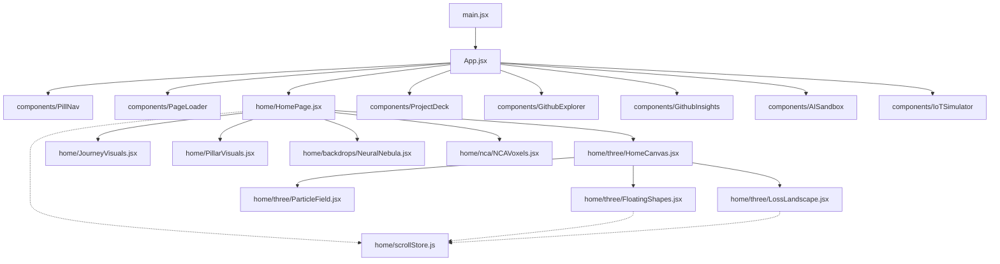

# Project Architecture & Codebase Map

## Architecture Overview

---

## File & Directory Summary

### Root Configuration & Entry
- **`index.html`**: Entry HTML shell defining metadata, font imports, preconnect headers, and the mounting target `#root`.
- **`package.json`**: Project manifest declaring dependencies (React 19, Three.js, GSAP, Lenis, Lucide), build scripts, and deployment configuration.
- **`vite.config.js`**: Vite build configuration including React plugin integration and asset handling.
- **`scripts/optimize-images.mjs`**: Asset optimization script utilizing `sharp` to process and convert raw images into high-efficiency WebP files.
- **`scripts/nca/train_nca.py`**: PyTorch script for training and exporting Neural Cellular Automata weight checkpoints.

### Application Core (`src/`)
- **`src/main.jsx`**: Main client entry point mounting `<App />` within React StrictMode.
- **`src/App.jsx`**: Central application state coordinator handling navigation between views, color themes (light/dark), and data props.
- **`src/App.css`**: Top-level layout and container styles for core view frames.
- **`src/index.css`**: Global design tokens, CSS custom properties (color palettes, typography scales), and reset rules.

### Interactive Home Section (`src/home/`)
- **`src/home/HomePage.jsx`**: Core landing page orchestrating the Hero, Interactive About, Horizontal Academic Journey, Technical Pillars, and Interactive Outro.
- **`src/home/HomePage.css`**: Styles for the pinned horizontal timeline, marker highlights, responsive breakpoints, and typography.
- **`src/home/JourneyVisuals.jsx`**: Interactive milestone preview cards and responsive visual assets for academic milestones.
- **`src/home/JourneyVisuals.css`**: Layout styles, media wrappers, and responsive styling for journey milestones.
- **`src/home/PillarVisuals.jsx`**: Flat technical-drawing illustrations for the three discipline cards (neural network, server rack, browser wireframe).
- **`src/home/scrollStore.js`**: Centralized reactive state store sharing scroll progression, stage transitions, and pointer coordinates between DOM and Canvas layers.
- **`src/home/three/HomeCanvas.jsx`**: React Three Fiber Canvas container managing WebGL rendering, camera parameters, and lights.
- **`src/home/three/FloatingShapes.jsx`**: Three.js floating procedural meshes with custom matcap materials responding to scroll stages.
- **`src/home/three/ParticleField.jsx`**: Ambient 3D particle dust giving depth to the background scene.
- **`src/home/three/LossLandscape.jsx`**: Interactive 3D Adam optimizer loss surface in Three.js where gradient descent navigates collaboration valleys.
- **`src/home/three/shapes.js`**: Mathematical geometry definitions and initialization helpers for 3D floating meshes.
- **`src/home/nca/NCAVoxels.jsx`**: 3D Neural Cellular Automata voxel pattern growth visualizer with user interaction.
- **`src/home/nca/nca.worker.js`**: Web Worker executing NCA model inference cycles off the main UI thread.
- **`src/home/backdrops/NeuralNebula.jsx`**: 2D HTML5 canvas backdrop rendering interactive neural network connection nodes.
- **`src/home/backdrops/WireframeHorizon.jsx`**: Perspective wireframe horizon canvas animation rendered in the site footer.
- **`src/home/backdrops/useCanvasLoop.js`**: Reusable hook providing an optimized `requestAnimationFrame` drawing loop for HTML5 canvas elements.

### Shared Custom Hooks (`src/hooks/`)
- **`src/hooks/useLenis.js`**: Hook initializing Lenis smooth scrolling with bidirectional GSAP ScrollTrigger synchronization.
- **`src/hooks/themeTransition.js`**: Circular expand reveal animation for theme transitions using the View Transitions API.

### UI Components (`src/components/`)
- **`src/components/AISandbox/`**: Live AI sandbox component showcasing interactive prompt experiments.
- **`src/components/AttentionText/`**: Animated text highlighting component drawing focus to key phrases.
- **`src/components/BounceCards/`**: Interactive physics-driven bouncing project preview cards.
- **`src/components/GithubExplorer/`**: Live GitHub API repository visualizer with filtering and stats.
- **`src/components/GithubInsights/`**: In-depth repository and activity analytics dashboard displaying language distributions and commit stats.
- **`src/components/IoTSimulator/`**: Virtual IoT device telemetry dashboard with simulated sensor streams.
- **`src/components/Lanyard/`**: Interactive 3D physics ID badge using `@react-three/rapier`.
- **`src/components/LightRays/`**: Ambient volumetric lighting effect overlay.
- **`src/components/OscilloscopeDivider/`**: Dynamic audio frequency wave separator between sections.
- **`src/components/PageLoader/`**: Multilingual animated introduction screen preloading critical assets.
- **`src/components/PillNav/`**: Floating glassmorphic navigation pill with active tab indicator and day/night toggle.
- **`src/components/ProjectDeck/`**: Smooth stacked card deck interface for exploring featured engineering projects.
- **`src/components/RadarChart/`**: Skills matrix visualization rendered as a polygon radar chart.
- **`src/components/TerminalCLI/`**: Interactive simulated command-line shell with custom commands and portfolio navigation.

---

## Portfolio v2 (`/home2/`, `/projects2/`, `/skills2/`, `/github2/`, `/blog2/`)

A second, manga-styled portfolio that lives alongside the original site (which is untouched at `/`).
Each route is its own static folder (`home2/index.html`, ...) registered as a Vite multi-page input in
`vite.config.js`, so it works on GitHub Pages without a SPA fallback. Every folder boots the same bundle,
`src/v2/main.jsx`, which picks the page from the URL. Blog posts are served at `/blog2/?post=<slug>`.

- **`src/v2/data/portfolio.js`**: All v2 content (profile, bio, timeline, projects, skills, tech logos), ported from `src/App.jsx`.
- **`src/v2/core/`**: `store.js` (scroll/pointer state shared with WebGL), `smooth.js` (Lenis on the GSAP ticker, scroll lock), `reveal.js` (declarative `data-anim` scroll animations), `intro.js` (loader/transition signals + page navigation), `useGithubSummary.js` (live GitHub data, reusing the v1 cached data layer).
- **`src/v2/components/`**: `Shell` (nav, opening loader, page-transition curtain, custom cursor, velocity speed lines, footer), `PageHero`, `HeroArt` (manga hero art and dynamic page illustrations), `Radar`, `Cover` (generative blog art), `Hanko`, `ProjectLogo`, `GithubLive`.
- **`src/v2/three/Scene3D.jsx`**: Cel-shaded R3F scene (toon ramp + ink outlines): torii-gate corridor, sakura petals, shards and a neural core; the camera flies through it with page scroll.
- **`src/v2/story/`**: the scroll story's art kit. `Rig.jsx` + `pose.js` (jointed SVG ninja / samurai / oni characters, poses and run/walk cycles), `Scenery.jsx` + `world.js` (procedural ink mountains, village, dojo, bamboo, weapons), `ThousandGates.jsx` (procedural torii gate corridor).
- **`src/v2/pages/`**: `Home2` (an 8-chapter scroll story: each `.scene` is a tall section with a sticky stage whose scrubbed GSAP timeline drives characters, parallax layers, captions and transitions), `Projects2` (filter + detail sheet), `Skills2`, `Github2`, `Blog2` (index + post reader).
- **`src/v2/blog/`**: `posts/*.md` (front matter: title, date, tags, excerpt, motif, kanji) and `posts.js` (loader + tiny Markdown renderer). Add a post by dropping a new `.md` file in `posts/`.
- **`src/v2/styles/`**: `base.css` (design tokens + shared components), `story.css`, `pages.css`, `blog.css`.
